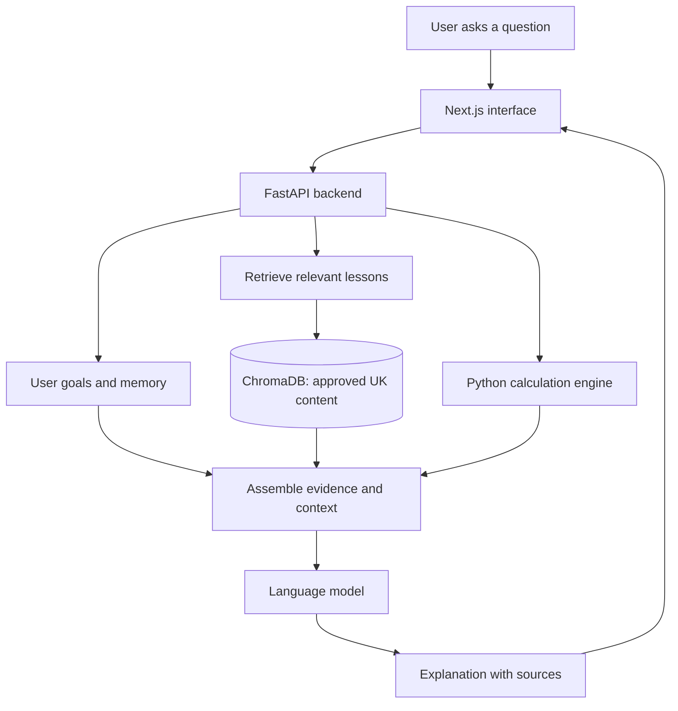

<div align="center">

# NetValor

### Understand your money. Learn at your pace. Make informed decisions.

**NetValor is a UK-focused financial-literacy web app in early development.**

It pairs short lessons and personal goals with an AI learning companion that answers from cited UK sources. Its explanations focus on *why* something matters for your finances, so you can weigh your options yourself.

[](https://www.figma.com/proto/YuR50qCdlhFfWwy9fbVoRb/NetValor-UI-UX?node-id=2-1194&p=f&scaling=min-zoom&content-scaling=fixed&page-id=0%3A1)
[](https://www.figma.com/design/YuR50qCdlhFfWwy9fbVoRb/Untitled)


</div>

> [!IMPORTANT]
> **Project status — October 2026:** The desktop and mobile UI designs are complete in Figma. A local backend can now search the draft lessons and stream co-pilot answers based on them. The frontend and a production-ready service are still in development, so the features and architecture below describe the intended product, not a released one.

---

## At a glance

| | |
| --- | --- |
| **The problem** | Financial information can be scattered, jargon-heavy and difficult to apply to everyday decisions. |
| **The idea** | A personal financial-literacy teacher that explains concepts in plain English and adapts lessons to the user's goals. |
| **Who it's for** | People in the UK who want to build confidence with budgeting, debt, savings and other money topics. |
| **What makes it different** | UK-focused learning content, transparent sources, user-controlled contextual memory and calculations handled by code. |
| **Current stage** | UI designs complete for desktop and mobile; initial local backend with lesson search and a streaming co-pilot API. |

## The experience

NetValor is being designed around five connected areas:

| Area | Planned experience |
| :--- | :--- |
| **Overview** | A snapshot of income, spending, debt, emergency savings and a possible next learning step. |
| **My co-pilot** | Ask financial questions in everyday language and receive educational answers supported by source references. |
| **My money** | Understand money coming in, spending by category and what remains after commitments. |
| **Learning path** | Follow short lessons that develop from cash flow and budgeting to debt management and saving. |
| **Goals** | Break a goal, such as building an emergency fund or reducing debt, into understandable milestones. |

The long-term aim is to connect these parts into one learning experience: understand your position, learn a concept, explore your options and track progress.

## Explore the design

The Figma prototype holds the finished design work and is currently the best way to see how the app is meant to look and work.

### [→ Open the interactive NetValor prototype](https://www.figma.com/proto/YuR50qCdlhFfWwy9fbVoRb/NetValor-UI-UX?node-id=2-1194&p=f&scaling=min-zoom&content-scaling=fixed&page-id=0%3A1)

[Open the Figma design file](https://www.figma.com/design/YuR50qCdlhFfWwy9fbVoRb/Untitled)

The design includes **five desktop screens and corresponding mobile layouts**, with a visual language intended to feel calm, legible and accessible.

| Design element | Choice |
| --- | --- |
| Headings | **Lora** |
| Interface and body text | **Inter** |
| Dark green | `#173F30` |
| Primary green | `#215641` |
| Warm background | `#F6F5F0` |
| Soft accent | `#B9D19F` |
| Secondary text | `#646C65` |

Accessibility is part of the design process, including attention to readable contrast and responsive layouts. A full accessibility audit is still planned.

<!-- OPTIONAL SCREENSHOT: Export a frame from Figma as assets/netvalor-preview.png,
     commit it to the repository, then uncomment the line below.

-->

## How NetValor is intended to work

NetValor uses **Retrieval-Augmented Generation (RAG)**. Before the language model answers, the backend retrieves passages from approved lesson material, so explanations are built from those sources rather than from the model's general knowledge alone.



The intended answer flow is:

1. **Retrieve:** Find relevant passages from approved learning materials, tagged by topic and UK jurisdiction.
2. **Remember:** Use only the goals and context the user has chosen to save.
3. **Calculate:** Use tested Python functions for figures such as repayment estimates instead of relying on the language model's arithmetic.
4. **Explain:** Produce a plain-English educational response, cite its sources and acknowledge uncertainty when evidence is insufficient.

> Retrieval and the streaming co-pilot API exist as an initial local implementation. The Next.js frontend, production deployment, lesson fact review and end-to-end evaluation are still to come.

## Tech stack

FastAPI, ChromaDB, Ollama and SQLite are already used by the local backend. It stores accounts, profiles, memory and conversations in SQLite, and it can encrypt personal data at rest. The other layers are planned.

| Layer | Technology | Intended role |
| :--- | :--- | :--- |
| **Frontend** | Next.js, React, TypeScript | Responsive interface and streamed responses |
| **Backend** | Python, FastAPI | APIs, user profiles and application logic |
| **RAG orchestration** | LangChain | Retrieval and prompt assembly |
| **Vector store** | ChromaDB | Indexed lesson passages |
| **Embeddings** | Ollama embedding models | Semantic search over educational material |
| **Language model** | Ollama or a hosted model API | Generate explanations from retrieved context |
| **Application database** | SQLite, later PostgreSQL | Store goals, progress and user-managed memory |
| **Evaluation** | RAGAS and manual testing | Check retrieval quality, factual grounding and safety |

## UK knowledge base

The lessons will be original, beginner-friendly material written with reference to established UK sources, including:

- [MoneyHelper](https://www.moneyhelper.org.uk/) — money guidance and educational resources.
- [Financial Conduct Authority](https://www.fca.org.uk/) — financial regulation and consumer information.
- [GOV.UK / HMRC](https://www.gov.uk/browse/tax) — UK tax information and government guidance.
- [StepChange](https://www.stepchange.org/) — free debt advice and support.
- [Citizens Advice](https://www.citizensadvice.org.uk/) — consumer rights and practical guidance.

**Source quality and reuse matter.** Public information is not automatically free to copy into a dataset. The project plans to record source URLs, licensing, review status and effective dates, and to use original lesson summaries or licensed material where appropriate. Time-sensitive information such as tax thresholds needs an applicable tax year.

## Responsible AI by design

Personal-finance education comes with real risks. These are the safeguards NetValor is being designed around:

- **Education before recommendations:** Explain concepts, choices and trade-offs; do not present the app as a source of regulated financial advice.
- **Evidence over confidence:** Cite the source material used and say when the evidence is incomplete.
- **Calculations in code:** Check financial figures with dedicated, tested functions.
- **User control:** Let users view, update and remove information saved about their goals.
- **Sensitive situations:** Direct users experiencing urgent debt problems to appropriate free support rather than pretending a chatbot can resolve everything.
- **Privacy by design:** Avoid collecting bank passwords, login credentials or full account numbers.

These are **design requirements**. Some, such as citations and retrieving only approved lessons by default, are in the initial backend. All of them need testing and review before release.

## Roadmap

- [x] Define the product concept and UK financial-education focus.
- [x] Complete five desktop UI designs and their mobile counterparts in Figma.
- [ ] **Sprint 1 — Content:** Review the eight original introductory lessons on budgeting, debt and saving.
- [x] **Sprint 2 — Retrieval:** Build the ingestion pipeline, embeddings and vector search.
- [x] **Sprint 3 — AI backend:** Create the FastAPI chat endpoint, streamed answers, citations and user-controlled memory.
- [ ] **Sprint 4 — Application:** Implement the Next.js dashboard, co-pilot, goals and budgeting calculator.
- [ ] **Sprint 5 — Quality:** Evaluate with 50–100 representative questions, calculation tests and safety checks.
- [ ] **Later:** Expand into saving, investing, pensions and tax; add onboarding and complete an accessibility audit.

## Project layout

```text
NetValor/
├── backend/                        # See backend/README.md for full details
│   ├── app/
│   │   ├── main.py                 # App factory and wiring
│   │   ├── config.py               # Typed settings with production safety checks
│   │   ├── api/                    # Routes, auth/ownership, error handling
│   │   ├── chat.py                 # Co-pilot pipeline
│   │   ├── calc_intent.py          # Interprets calculation requests; asks when unsure
│   │   ├── finance.py              # Deterministic Decimal calculations
│   │   ├── grounding.py            # Citation, figure and safety checks
│   │   ├── retrieval.py            # Async lesson vector search
│   │   ├── users.py, memory.py, conversations.py   # SQLite storage
│   │   ├── migrations/             # Numbered SQL schema migrations
│   │   └── knowledge/
│   │       ├── lessons/            # Original UK learning materials (draft)
│   │       └── scripts/ingest.py   # Content indexing
│   ├── evals/                      # Offline and live AI evaluation suite
│   └── tests/                      # Offline pytest suite
├── .github/workflows/backend.yml   # Lint, type-check, test and evaluate
├── frontend/
│   ├── app/                        # Next.js routes
│   ├── components/                 # Reusable UI components
│   └── lib/                        # API client and helpers
├── README.md
└── LICENSE
```

## Getting started

Only the backend can be run at the moment. You need **Python 3.12+** and [Ollama](https://ollama.com/), which provides both the embeddings and the chat model locally. **Node.js 20+** will be needed once the frontend is added. The commands below are for PowerShell and start from the repository root. [`backend/README.md`](backend/README.md) covers configuration, the security model, calculation assumptions, evaluation and data migration in full. Never commit secrets or `.env` files.

### 1. Install, test and start the API

```powershell
cd backend
python -m venv .venv
.venv\Scripts\Activate.ps1
python -m pip install -r requirements-dev.txt
Copy-Item .env.example .env
python -m pytest
python -m uvicorn app.main:app --reload
```

Open [http://127.0.0.1:8000/docs](http://127.0.0.1:8000/docs) to try the API. Profile, memory, chat and conversation endpoints require a bearer token from `POST /api/auth/login`, and each user can only access their own data. For a local demo account, set `SEED_DEMO_USER=true` and a `DEMO_USER_PASSWORD` of at least 12 characters in `backend/.env`. You can also register your own account with `POST /api/auth/register`. Lesson search and chat depend on Ollama and the lesson index, which you set up in the next steps.

Chat, search and the lesson list use only approved lessons by default. The supplied lessons are unreviewed drafts, so set `ALLOW_DRAFT=true` in `backend/.env` for local testing until they have been fact-reviewed. Answers based on drafts are labelled as such.

### 2. Build the lesson index

Install and start Ollama, then run:

```powershell
ollama pull embeddinggemma-2:270m
cd backend
$env:EMBEDDING_MODEL = "embeddinggemma-2:270m"
$env:CHROMA_DIR = "data/chroma"
$env:OLLAMA_URL = "http://localhost:11434"
python -m app.knowledge.scripts.ingest
python -m uvicorn app.main:app --reload
```

To check the index, open `/docs`, expand **GET `/api/search`**, choose **Try it out**, enter a question such as `Why does my credit card balance go down so slowly?`, and execute. The endpoint returns matching lesson chunks with their similarity scores and source metadata. **GET `/api/lessons`** and **GET `/api/lessons/{lesson_id}`** list and serve the source lessons used to build the index.

### 3. Run the co-pilot

Start Ollama in its own PowerShell terminal. If an Ollama tray app or server is already running, close it first so the context-length setting takes effect:

```powershell
ollama pull qwen3.5:9b-q4_K_M
ollama pull gemma4:12b
ollama pull ministral-3:8b
$env:OLLAMA_CONTEXT_LENGTH = "8192"
ollama serve
```

In a second terminal, start the API from the repository root. Set `ALLOW_DRAFT=true` only while testing the unreviewed starter lessons. Qwen is the default; set `LLM_MODEL` to `gemma4:12b` or `ministral-3:8b` to use Gemma or Ministral instead:

```powershell
Set-Location backend
$env:OLLAMA_URL = "http://localhost:11434"
$env:LLM_MODEL = "qwen3.5:9b-q4_K_M"
$env:LLM_NUM_CTX = "8192"
$env:ALLOW_DRAFT = "true"
# For Gemma 4 12B, use this instead:
# $env:LLM_MODEL = "gemma4:12b"
# For Ministral 3 8B, use this instead:
# $env:LLM_MODEL = "ministral-3:8b"
python -m uvicorn app.main:app --reload
```

From a third terminal, log in and send a test question to the streaming chat endpoint:

```powershell
$login = Invoke-RestMethod -Method Post http://127.0.0.1:8000/api/auth/login `
  -ContentType "application/json" `
  -Body '{"user_id":"alex","password":"<your DEMO_USER_PASSWORD>"}'
curl.exe -N -X POST http://127.0.0.1:8000/api/chat/alex `
  -H "Authorization: Bearer $($login.access_token)" `
  -H "Content-Type: application/json" `
  -d '{\"message\":\"Why does my credit card balance go down so slowly?\"}'
```

The stream contains `token` events, then either a `done` event or an `error` event with a `code`. The `done` event carries the citations, verified calculations, grounding checks, notices and the conversation ID. If a calculation request is ambiguous, NetValor asks a clarifying question instead of guessing. Saved conversations are available at `/api/conversations/alex` and `/api/conversations/alex/{conversation_id}` with the same token.

If you used an earlier version that stored profiles as JSON, import them with `python -m app.cli import-json`. Your original files are left unchanged. See `backend/README.md` for details.

## Why I'm building this

I started NetValor because learning about personal finance should not depend on knowing the right jargon or already understanding the system. I want to explore how software and carefully grounded AI can make financial education clearer, more personal and more useful—without turning it into product sales or pretending a chatbot is a financial adviser.

The project is also a chance to build and evaluate a full-stack RAG application end to end, from interface design and content preparation through retrieval, APIs, testing and responsible AI behaviour.

## Licence

The project is intended to use the [MIT License](LICENSE). Check the repository for the licence file before reusing code.

---

<div align="center">

**NetValor is an educational software project, not a financial adviser.**

For free debt support in the UK, visit [MoneyHelper](https://www.moneyhelper.org.uk/) or [StepChange](https://www.stepchange.org/).

[↑ Back to top](#netvalor)

</div>
