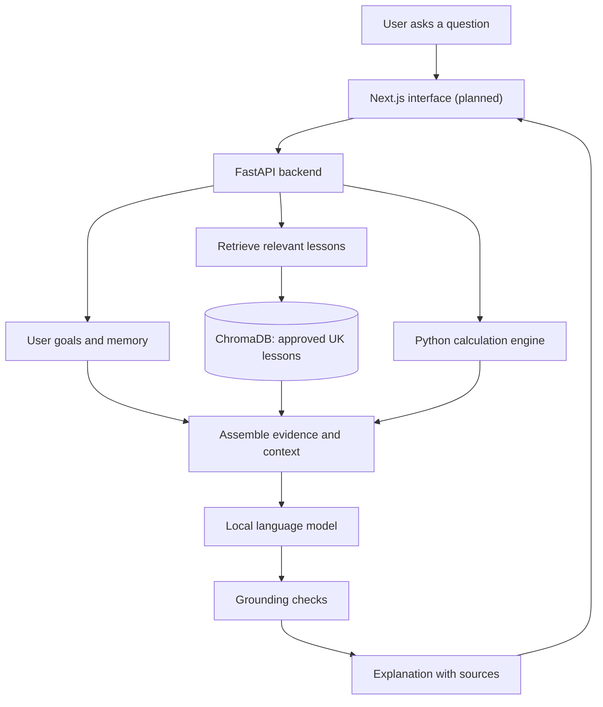

<div align="center">

# NetValor

### Understand your money. Learn at your pace. Make informed decisions.

**A UK financial-literacy web app with an AI tutor that answers from cited lessons.**

NetValor is for people who feel lost with money. You get short lessons and your own goals, plus an AI co-pilot that explains things in plain English and shows where each answer came from. It explains *why* something matters, so you can make the decision yourself.

[](https://www.figma.com/proto/YuR50qCdlhFfWwy9fbVoRb/NetValor-UI-UX?node-id=2-1194&p=f&scaling=min-zoom&content-scaling=fixed&page-id=0%3A1)
[](https://www.figma.com/design/YuR50qCdlhFfWwy9fbVoRb/Untitled)

[](https://github.com/Valorz1/NetValor/actions/workflows/backend.yml)


</div>

> [!IMPORTANT]
> **Status, November 2026:** The backend works locally and is well tested. The web interface is designed in Figma but not built yet, and the eight starter lessons still need a fact review. NetValor isn't ready for real users.

---

## What works today

You can run the backend on your own machine and use it through its API:

- **Create an account and log in.** Each user can only see their own data, and personal data can be encrypted at rest.
- **Save your money picture.** Store your income, debts and goals, plus notes you want the co-pilot to remember. You can edit or delete any of it.
- **Ask the co-pilot a question.** It finds the most relevant lesson passages and answers from them with a local model, streaming the reply and citing its sources. If the lessons don't cover something, it says so instead of guessing.
- **Get real numbers.** Ask something like "what if I pay an extra £120 a month on my card?" and the figures come from tested Python code, not the model. If the question is unclear, it asks you to clarify rather than guess.
- **Browse and search the lessons.** Eight starter lessons cover budgeting, debt and saving.

The backend has 364 offline tests and an evaluation suite that checks the co-pilot's behaviour. GitHub Actions runs both whenever backend code changes on `main` or in a pull request.

## Why I'm building this

I’m building NetValor for people who find money confusing. A lot of people in the UK were never taught how to manage their money or protect themselves, and most of the help out there is either full of jargon or quietly trying to sell you something.

I believe financial literacy is a fundamental right. Whether you're young, old or just starting your career, financial knowledge shouldn’t be a privilege reserved for the wealthy. It should be accessible to everyone, regardless of their income or background.

That’s why NetValor is completely free, and I’m not building it to make money. There are no ads, no commission and nothing to sell. NetValor is there to teach, not to give financial advice, and when someone needs more help it points them to free, trusted services.

Building NetValor is also how I’m teaching myself to make a full RAG (retrieval-augmented generation) application from scratch, from the design and content through to testing and safety.

## The problem

- **24% of UK adults (13.1 million people) have low financial resilience**, meaning little savings, heavy bills or credit, or missed payments. (FCA Financial Lives 2024)
- **1 in 10 UK adults have no cash savings at all.** (FCA Financial Lives 2024)

Sources: [FCA Financial Lives survey](https://www.fca.org.uk/financial-lives)

## The app

The app has five areas, all designed in Figma:

| Area | What it does |
| :--- | :--- |
| **Overview** | A snapshot of income, spending, debt and savings, with one suggested next step. |
| **My co-pilot** | Ask money questions in everyday language and get answers with sources. |
| **My money** | See money coming in, spending by category and what's left after bills and repayments. |
| **Learning path** | Short lessons that build from cash flow and budgeting to debt and saving. |
| **Goals** | Turn a goal, like an emergency fund or clearing a card, into milestones. |

## Explore the design

The Figma prototype is the best way to see how NetValor will look and feel.

### [→ Open the interactive NetValor prototype](https://www.figma.com/proto/YuR50qCdlhFfWwy9fbVoRb/NetValor-UI-UX?node-id=2-1194&p=f&scaling=min-zoom&content-scaling=fixed&page-id=0%3A1)

[Open the Figma design file](https://www.figma.com/design/YuR50qCdlhFfWwy9fbVoRb/Untitled)

There are five desktop screens. Mobile layouts are done for most of them; the Goals screen is still to come. I went for a calm look that's easy to read:

| Design element | Choice |
| --- | --- |
| Headings | **Lora** |
| Interface and body text | **Inter** |
| Dark green | `#173F30` |
| Primary green | `#215641` |
| Warm background | `#F6F5F0` |
| Soft accent | `#B9D19F` |
| Secondary text | `#646C65` |

Body and secondary text meet WCAG AA contrast. A full accessibility audit will happen once the frontend exists.

<!-- OPTIONAL SCREENSHOT: Export a frame from Figma as assets/netvalor-preview.png,
     commit it to the repository, then uncomment the line below.

-->

## How the co-pilot answers

NetValor uses **retrieval-augmented generation (RAG)**. Before the model writes anything, the backend pulls the relevant passages from approved lessons, so answers come from that material rather than from whatever the model happens to know.



For each question, the backend:

1. **Finds the evidence.** It searches the approved lessons for the passages that best match the question.
2. **Adds what you've chosen to share.** Only the goals and notes you've saved go into the prompt.
3. **Works out any numbers in code.** Repayment estimates and savings figures come from tested Python functions.
4. **Writes the answer.** The model explains the evidence in plain English and cites each passage it uses.
5. **Checks the answer.** It removes citations that don't match a real passage, flags numbers that didn't come from the calculation engine, and points people with urgent money problems to free support.

## Tech stack

| Layer | Technology | Status |
| :--- | :--- | :--- |
| **Backend** | Python 3.12+, FastAPI | Built |
| **RAG pipeline** | My own retrieval, prompt and grounding code (no framework) | Built |
| **Vector store** | ChromaDB | Built |
| **Embeddings** | EmbeddingGemma 2 via Ollama | Built |
| **Language model** | Qwen3.5 9B via Ollama by default; Gemma 4 12B and Ministral 3 8B also work | Built, being compared |
| **Database** | SQLite with numbered migrations, PostgreSQL later | Built |
| **Security** | Encrypted personal data, session tokens, rate limits | Built |
| **Testing** | pytest, ruff, strict mypy, a custom AI evaluation suite | Built |
| **CI** | GitHub Actions on Python 3.12 and 3.13 | Built |
| **Frontend** | Next.js, React, TypeScript | Next up |

## UK knowledge base

The lessons are my own beginner-friendly writing, based on trusted UK sources such as:

- [MoneyHelper](https://www.moneyhelper.org.uk/) for money guidance
- [Financial Conduct Authority](https://www.fca.org.uk/) for regulation and consumer information
- [GOV.UK / HMRC](https://www.gov.uk/browse/tax) for tax and government guidance
- [StepChange](https://www.stepchange.org/) for free debt advice
- [Citizens Advice](https://www.citizensadvice.org.uk/) for consumer rights and practical help

**I don't copy other people's material into the dataset.** Being public doesn't make something free to reuse, so I link and cite these sources and write the lessons in my own words. Each lesson records its sources, licence and review status. Facts that change over time, like tax thresholds, need a tax year attached.

## Safety and responsibility

Money advice can cause real harm when it's wrong, so these rules are built into the backend:

- **Education, not advice.** NetValor explains options and trade-offs. It won't tell you which financial product to pick.
- **Evidence first.** Every answer cites its sources, and the co-pilot says when the lessons don't cover something.
- **Numbers from code.** The model never does the maths.
- **You control your data.** You can view, edit and delete anything saved about you.
- **Help in a crisis.** Mentions of things like bailiffs or arrears trigger signposting to free debt advice.
- **Privacy.** NetValor never asks for bank passwords, logins or full account numbers.

The evaluation suite tests these rules, including attempts to slip instructions into a question, a saved note or a lesson. Passing automated checks doesn't prove every answer is right, so the lessons still need a human fact review before anyone relies on them.

## Roadmap

- [x] Define the product idea and its UK focus.
- [x] Design five desktop screens in Figma, with mobile layouts for most of them.
- [x] **Retrieval:** lesson ingestion and vector search.
- [x] **AI backend:** streaming chat, citations, grounding checks and user-controlled memory.
- [x] **Accounts and storage:** sign-in, SQLite, encryption at rest and rate limits.
- [x] **Automated checks:** tests, linting, type checks and offline evaluation in GitHub Actions.
- [ ] **Content:** fact-check the eight starter lessons and mark them approved.
- [ ] **Model choice:** run the evaluation against live models and pick a default.
- [ ] **Application:** build the Next.js app from the Figma designs, starting with the co-pilot chat page.
- [ ] **Quality:** grow the evaluation set to 50–100 questions and test with real users.
- [ ] **Later:** lessons beyond the basics, such as pensions and tax, plus onboarding and an accessibility audit.

## Project layout

```text
NetValor/
├── backend/                        # See backend/README.md for full details
│   ├── app/
│   │   ├── main.py                 # App factory and wiring
│   │   ├── config.py               # Typed settings with production safety checks
│   │   ├── api/                    # Routes, auth/ownership, error handling
│   │   ├── chat.py                 # Co-pilot pipeline
│   │   ├── calc_intent.py          # Interprets calculation requests; asks when unsure
│   │   ├── finance.py              # Deterministic Decimal calculations
│   │   ├── grounding.py            # Citation, figure and safety checks
│   │   ├── retrieval.py            # Async lesson vector search
│   │   ├── users.py, memory.py, conversations.py   # SQLite storage
│   │   ├── migrations/             # Numbered SQL schema migrations
│   │   └── knowledge/
│   │       ├── lessons/            # Original UK learning materials (draft)
│   │       └── scripts/ingest.py   # Content indexing
│   ├── evals/                      # Offline and live AI evaluation suite
│   └── tests/                      # Offline pytest suite
├── .github/workflows/backend.yml   # Lint, type-check, test and evaluate
├── frontend/                       # Next.js app (not started yet)
│   ├── app/
│   ├── components/
│   └── lib/
├── README.md
└── LICENSE
```

## Getting started

For now you can only run the backend. You'll need **Python 3.12+** and [Ollama](https://ollama.com/), which runs both the embedding model and the chat model on your machine. The commands are for PowerShell and start from the repository root. [`backend/README.md`](backend/README.md) covers everything else, from configuration and security to data migration. Never commit secrets or `.env` files.

### 1. Install, test and start the API

```powershell
cd backend
python -m venv .venv
.venv\Scripts\Activate.ps1
python -m pip install -r requirements-dev.txt
Copy-Item .env.example .env
python -m pytest
python -m uvicorn app.main:app --reload
```

Open [http://127.0.0.1:8000/docs](http://127.0.0.1:8000/docs) to try the API. The profile, memory, chat and conversation endpoints need a bearer token from `POST /api/auth/login`. To use the local demo account, set `SEED_DEMO_USER=true` and a `DEMO_USER_PASSWORD` of at least 12 characters in `backend/.env`, or register your own account with `POST /api/auth/register`. Search and chat also need Ollama and the lesson index, which the next steps set up.

By default, chat, search and the lesson list only use approved lessons. The starter lessons are still drafts, so set `ALLOW_DRAFT=true` in `backend/.env` while testing locally. Answers based on drafts are labelled.

### 2. Build the lesson index

Install and start Ollama, then run:

```powershell
ollama pull embeddinggemma-2:270m
cd backend
$env:EMBEDDING_MODEL = "embeddinggemma-2:270m"
$env:CHROMA_DIR = "data/chroma"
$env:OLLAMA_URL = "http://localhost:11434"
python -m app.knowledge.scripts.ingest
python -m uvicorn app.main:app --reload
```

To check the index, open `/docs`, expand **GET `/api/search`**, choose **Try it out**, enter a question such as `Why does my credit card balance go down so slowly?` and press **Execute**. You'll get back the matching lesson chunks with their similarity scores and sources. **GET `/api/lessons`** and **GET `/api/lessons/{lesson_id}`** list and show the lessons themselves.

### 3. Run the co-pilot

Start Ollama in its own PowerShell window. If the Ollama tray app is already running, close it first so the context-length setting takes effect:

```powershell
ollama pull qwen3.5:9b-q4_K_M
ollama pull gemma4:12b
ollama pull ministral-3:8b
$env:OLLAMA_CONTEXT_LENGTH = "8192"
ollama serve
```

In a second window, start the API from the repository root. Qwen is the default. To try Gemma or Ministral instead, set `LLM_MODEL` to `gemma4:12b` or `ministral-3:8b`:

```powershell
Set-Location backend
$env:OLLAMA_URL = "http://localhost:11434"
$env:LLM_MODEL = "qwen3.5:9b-q4_K_M"
$env:LLM_NUM_CTX = "8192"
$env:ALLOW_DRAFT = "true"
# For Gemma 4 12B, use this instead:
# $env:LLM_MODEL = "gemma4:12b"
# For Ministral 3 8B, use this instead:
# $env:LLM_MODEL = "ministral-3:8b"
python -m uvicorn app.main:app --reload
```

In a third window, log in and send a test question:

```powershell
$login = Invoke-RestMethod -Method Post http://127.0.0.1:8000/api/auth/login `
  -ContentType "application/json" `
  -Body '{"user_id":"alex","password":"<your DEMO_USER_PASSWORD>"}'
curl.exe -N -X POST http://127.0.0.1:8000/api/chat/alex `
  -H "Authorization: Bearer $($login.access_token)" `
  -H "Content-Type: application/json" `
  -d '{\"message\":\"Why does my credit card balance go down so slowly?\"}'
```

The reply arrives as a stream of `token` events, followed by either a `done` event or an `error` event with a `code`. The `done` event includes the citations, any calculations, the grounding check results and the conversation ID. You can read saved conversations at `/api/conversations/alex` and `/api/conversations/alex/{conversation_id}` with the same token.

If you used an earlier version that saved profiles as JSON files, import them with `python -m app.cli import-json`. Your original files stay as they are. See `backend/README.md` for details.

## Licence

NetValor is released under the [MIT License](LICENSE).

---

<div align="center">

**NetValor is an educational project, not a financial adviser.**

For free debt support in the UK, visit [MoneyHelper](https://www.moneyhelper.org.uk/) or [StepChange](https://www.stepchange.org/).

[↑ Back to top](#netvalor)

</div>
