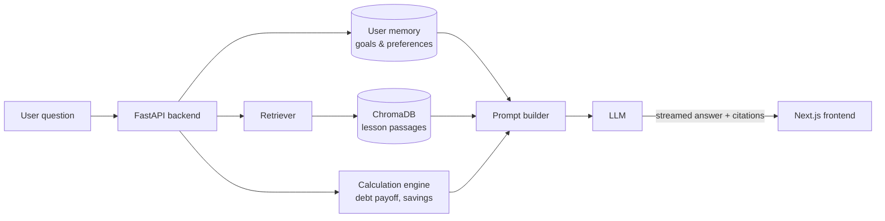

# NetValor

**An AI financial-literacy teacher that adapts to your situation and remembers your goals.**

NetValor is a web app that helps people understand their own money. Instead of generic advice, it gives plain-English explanations grounded in trusted UK sources, and it connects every answer to the user's own goals: paying off a credit card, building a safety net, or simply understanding where their money goes.

> 🚧 **Status: early development.** The UI design is complete (desktop and mobile). The backend and frontend code are in progress. See the [roadmap](#roadmap).

---

## Contents

- [Why NetValor](#why-netvalor)
- [Features](#features)
- [Design](#design)
- [How it works](#how-it-works)
- [Tech stack](#tech-stack)
- [Project structure](#project-structure)
- [Getting started](#getting-started)
- [Knowledge base and sources](#knowledge-base-and-sources)
- [Safety and responsible AI](#safety-and-responsible-ai)
- [Roadmap](#roadmap)
- [License](#license)

---

## Why NetValor

There is plenty of financial information online, but it's scattered, full of jargon and rarely tells you how it applies to *you*. NetValor aims to democratise financial education by acting as an impartial co-pilot that:

- **teaches**, rather than sells: no products, no commission
- **remembers** your long-term goals, so every answer builds on the last
- **shows its working**: sources are cited, and calculations come from tested code, not the language model
- **knows its limits**: it says when it's unsure and points people in financial difficulty to free, regulated debt advice

## Features

| Area | What it does |
| --- | --- |
| **Overview** | A calm snapshot of your money: breathing room, emergency fund, debt, and a single "next best step" |
| **My co-pilot** | A chat tutor with contextual memory. It answers questions using your remembered goals and retrieved lesson content, and shows what it's keeping in mind |
| **My money** | Income, spending by category and what's left after commitments |
| **Learning path** | Short, personalised lessons that build from cash flow to debt to saving |
| **Goals** | Progress toward goals such as a 3-month safety net or becoming debt-free, with milestones |

**Built-in principles:** user-controlled memory (view, edit or delete what's remembered), private by design, and education rather than regulated financial advice.

## Design

The full UI is designed in Figma, with five desktop screens and their mobile versions:

🎨 [NetValor design file (Figma)](https://www.figma.com/design/YuR50qCdlhFfWwy9fbVoRb/Untitled)

- **Typography:** Lora (headings) and Inter (body)
- **Palette:** deep green `#173F30`, primary `#215641`, warm neutrals `#F6F5F0`, accent `#B9D19F`
- **Accessibility:** body and secondary text meet WCAG AA contrast (secondary grey `#646C65`)

## How it works

NetValor uses **Retrieval-Augmented Generation (RAG)**. The model never answers from memory alone: it retrieves relevant lesson passages, combines them with the user's saved goals, and generates an explanation that cites its sources.



1. **Retrieve.** The question is embedded and matched against approved lesson passages in ChromaDB, filtered by topic and UK jurisdiction.
2. **Remember.** The user's goals (for example "debt-free by June 2027") are loaded from their profile.
3. **Calculate.** Any numbers, such as payoff dates or interest saved, come from a tested Python calculation engine.
4. **Generate.** The LLM writes a plain-English answer from that evidence and streams it to the UI, with sources.

## Tech stack

| Layer | Technology | Purpose |
| --- | --- | --- |
| Frontend | Next.js, React, TypeScript | Type-safe UI with real-time streaming responses |
| Backend | Python, FastAPI | API routing, user profiles, memory and progress |
| RAG | LangChain | Retrieval, prompt assembly and LLM orchestration |
| Vector DB | ChromaDB | Stores embedded lesson passages |
| Embeddings | Sentence Transformers | Turns text into vectors for search |
| LLM | Ollama (local) or a hosted API model | Generates explanations |
| Database | SQLite → PostgreSQL | Profiles, goals and learning progress |
| Evaluation | RAGAS + manual review | Measures retrieval and answer quality |

## Project structure

```
netvalor/
├── backend/
│   └── app/
│       ├── main.py            # FastAPI app and routes
│       ├── chat.py            # RAG pipeline and streaming
│       ├── memory.py          # User goals and remembered context
│       ├── finance.py         # Calculation engine (payoff, savings)
│       └── knowledge/
│           ├── lessons/       # Approved lesson passages (Markdown + metadata)
│           └── scripts/
│               ├── ingest.py  # Chunk, embed and load into ChromaDB
│               └── tests/
├── frontend/
│   ├── app/                   # Next.js App Router pages
│   ├── components/            # UI components (sidebar, chat, cards)
│   └── lib/                   # API client and streaming helpers
├── LICENSE
└── README.md
```

## Getting started

> These steps describe the intended setup. They'll work once the first backend and frontend code is committed.

### Prerequisites

- Python 3.11+
- Node.js 20+
- [Ollama](https://ollama.com) (optional, for running a local model)

### 1. Clone

```bash
git clone https://github.com/Valorz1/NetValor.git
cd NetValor
```

### 2. Backend

```bash
cd backend
python -m venv .venv

# Windows
.venv\Scripts\activate
# macOS / Linux
source .venv/bin/activate

pip install -r requirements.txt
cp .env.example .env             # then edit values

python app/knowledge/scripts/ingest.py   # build the vector index
uvicorn app.main:app --reload            # http://localhost:8000
```

### 3. Frontend

```bash
cd frontend
npm install
npm run dev                      # http://localhost:3000
```

### Environment variables

| Variable | Example | Description |
| --- | --- | --- |
| `LLM_PROVIDER` | `ollama` | `ollama`, or a hosted provider |
| `LLM_MODEL` | `llama3.1` | Model name for the chosen provider |
| `EMBEDDING_MODEL` | `all-MiniLM-L6-v2` | Sentence Transformers model |
| `CHROMA_DIR` | `./data/chroma` | Where the vector index is stored |
| `CORS_ORIGINS` | `http://localhost:3000` | Allowed frontend origin |
| `NEXT_PUBLIC_API_URL` | `http://localhost:8000` | Backend URL used by the frontend |

Never commit `.env` files or API keys.

## Knowledge base and sources

Lesson content is UK-focused and grounded in trusted sources such as MoneyHelper, the Financial Conduct Authority (FCA), HMRC / GOV.UK and StepChange.

**Licensing matters.** Publicly available doesn't mean free to reuse. NetValor's approach:

- **GOV.UK / HMRC** content is published under the [Open Government Licence v3.0](https://www.nationalarchives.gov.uk/doc/open-government-licence/version/3/) and may be ingested with attribution.
- **MoneyHelper** materials are licensed for non-commercial use with no derivatives ([terms](https://maps.org.uk/en/about-us/terms-and-conditions)), so they aren't scraped. They're linked and cited, and lessons are written as original summaries.
- **Other sources** (FCA, StepChange, Citizens Advice) are linked and cited until their reuse terms are confirmed.

Each passage stores metadata for traceability:

```json
{
  "document_id": "debt_001",
  "title": "Understanding credit card interest",
  "module": "Build your debt strategy",
  "difficulty": "beginner",
  "jurisdiction": "UK",
  "source": "MoneyHelper",
  "source_url": "https://www.moneyhelper.org.uk/...",
  "licence": "original-summary",
  "retrieved_at": "2026-10-19",
  "review_status": "approved"
}
```

Time-sensitive facts such as tax bands and allowances carry a tax-year or effective-date field, so outdated figures are never used silently.

## Safety and responsible AI

- **Education, not advice.** NetValor explains options and trade-offs. It does not recommend specific regulated products. A disclaimer alone doesn't decide whether something counts as regulated advice, so features are reviewed against FCA guidance as the scope grows.
- **Financial difficulty.** If a user mentions rent arrears, bailiffs or threatened disconnection, the co-pilot prioritises signposting to free debt advice over repayment optimisation.
- **Grounded answers.** Factual claims must be supported by retrieved passages, and the co-pilot says when the evidence is insufficient.
- **Tested numbers.** All calculations come from unit-tested code, including edge cases such as zero income or unaffordable repayments.
- **Privacy.** No bank credentials or account numbers are collected. Users can view, edit and delete their remembered context.

## Roadmap

- [x] UI design: 5 desktop screens and mobile versions (Figma)
- [ ] **Sprint 1:** write 30–50 approved lesson passages for budgeting and debt
- [ ] **Sprint 2:** ingestion pipeline and vector search
- [ ] **Sprint 3:** FastAPI chat endpoint with streaming, citations and memory
- [ ] **Sprint 4:** Next.js dashboard, co-pilot chat and budgeting calculator
- [ ] **Sprint 5:** evaluation (50–100 test questions) and safety checks
- [ ] Later: savings, investing, tax and pensions modules; onboarding; accessibility audit

## License

Released under the [MIT License](LICENSE).

---

*NetValor is an educational project. It provides financial education, not regulated financial advice. For help with debt, contact a free service such as [MoneyHelper](https://www.moneyhelper.org.uk) or [StepChange](https://www.stepchange.org).*
