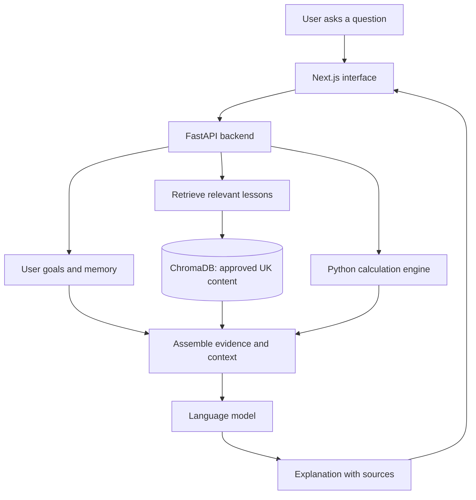

<div align="center">

# NetValor

### Understand your money. Learn at your pace. Make informed decisions.

**A UK-focused financial-literacy platform designed to make money management easier to understand.**

NetValor is an early-stage web app concept combining practical financial education, personal goals and a source-grounded AI learning companion. The aim is to help people understand *why* something matters for their finances—not just tell them what to do.

[](https://www.figma.com/proto/YuR50qCdlhFfWwy9fbVoRb/NetValor-UI-UX?node-id=2-1194&p=f&scaling=min-zoom&content-scaling=fixed&page-id=0%3A1)
[](https://www.figma.com/design/YuR50qCdlhFfWwy9fbVoRb/Untitled)


</div>

> [!IMPORTANT]
> **Project status — October 2026:** The desktop and mobile UI designs are complete in Figma. The backend now has an initial local knowledge-base and streaming co-pilot API; the frontend and production-ready service are still in development. The feature descriptions and architecture below explain the intended product, not a released product.

---

## At a glance

| | |
| --- | --- |
| **The problem** | Financial information can be scattered, jargon-heavy and difficult to apply to everyday decisions. |
| **The idea** | A personal financial-literacy teacher that explains concepts in plain English and adapts lessons to the user's goals. |
| **Who it's for** | People in the UK who want to build confidence with budgeting, debt, savings and other money topics. |
| **What makes it different** | UK-focused learning content, transparent sources, user-controlled contextual memory and calculations handled by code. |
| **Current milestone** | Interactive UI/UX prototype for desktop and mobile. |

## The experience

NetValor is being designed around five connected areas:

| Area | Planned experience |
| :--- | :--- |
| **Overview** | A straightforward snapshot of income, spending, debt, emergency savings and a possible next learning step. |
| **My co-pilot** | Ask financial questions in everyday language and receive educational answers supported by source references. |
| **My money** | Understand money coming in, spending by category and what remains after commitments. |
| **Learning path** | Follow short lessons that develop from cash flow and budgeting to debt management and saving. |
| **Goals** | Break a goal, such as building an emergency fund or reducing debt, into understandable milestones. |

The long-term aim is to connect these parts into one learning experience: understand your position, learn a concept, explore your options and track progress.

## Explore the design

**The interactive Figma prototype is the best place to see the project right now.** It contains the completed design work while development continues.

### [→ Open the interactive NetValor prototype](https://www.figma.com/proto/YuR50qCdlhFfWwy9fbVoRb/NetValor-UI-UX?node-id=2-1194&p=f&scaling=min-zoom&content-scaling=fixed&page-id=0%3A1)

[Open the Figma design file](https://www.figma.com/design/YuR50qCdlhFfWwy9fbVoRb/Untitled)

The design includes **five desktop screens and corresponding mobile layouts**, with a visual language intended to feel calm, legible and accessible.

| Design element | Choice |
| --- | --- |
| Headings | **Lora** |
| Interface and body text | **Inter** |
| Dark green | `#173F30` |
| Primary green | `#215641` |
| Warm background | `#F6F5F0` |
| Soft accent | `#B9D19F` |
| Secondary text | `#646C65` |

Accessibility is part of the design process, including attention to readable contrast and responsive layouts. A full accessibility audit is still planned.

<!-- OPTIONAL SCREENSHOT: Export a frame from Figma as assets/netvalor-preview.png,
     commit it to the repository, then uncomment the line below.

-->

## How NetValor is intended to work

NetValor's planned AI layer uses **Retrieval-Augmented Generation (RAG)** so explanations can be built around selected financial-education material rather than unsupported model output.



The intended answer flow is:

1. **Retrieve:** Find relevant passages from approved learning materials, tagged by topic and UK jurisdiction.
2. **Remember:** Use only the goals and context the user has chosen to save.
3. **Calculate:** Use tested Python functions for figures such as repayment estimates instead of relying on the language model's arithmetic.
4. **Explain:** Produce a plain-English educational response, cite its sources and acknowledge uncertainty when evidence is insufficient.

> The streaming co-pilot API and local RAG components are an initial implementation. The frontend, production deployment, lesson fact review and end-to-end evaluation are still in development.

## Planned tech stack

| Layer | Technology | Intended role |
| :--- | :--- | :--- |
| **Frontend** | Next.js, React, TypeScript | Responsive interface and streamed responses |
| **Backend** | Python, FastAPI | APIs, user profiles and application logic |
| **RAG orchestration** | LangChain | Retrieval and prompt assembly |
| **Vector store** | ChromaDB | Indexed lesson passages |
| **Embeddings** | Ollama embedding models | Semantic search over educational material |
| **Language model** | Ollama or a hosted model API | Generate explanations from retrieved context |
| **Application database** | SQLite, later PostgreSQL | Store goals, progress and user-managed memory |
| **Evaluation** | RAGAS and manual testing | Check retrieval quality, factual grounding and safety |

## UK knowledge base

The goal is to build original, beginner-friendly lessons using trustworthy UK references, including:

- [MoneyHelper](https://www.moneyhelper.org.uk/) — money guidance and educational resources.
- [Financial Conduct Authority](https://www.fca.org.uk/) — financial regulation and consumer information.
- [GOV.UK / HMRC](https://www.gov.uk/browse/tax) — UK tax information and government guidance.
- [StepChange](https://www.stepchange.org/) — free debt advice and support.
- [Citizens Advice](https://www.citizensadvice.org.uk/) — consumer rights and practical guidance.

**Source quality and reuse matter.** Public information is not automatically free to copy into a dataset. The project plans to record source URLs, licensing, review status and effective dates, and to use original lesson summaries or licensed material where appropriate. Time-sensitive information such as tax thresholds needs an applicable tax year.

## Responsible AI by design

Personal-finance education comes with real risks. These are the safeguards NetValor is being designed around:

- **Education before recommendations:** Explain concepts, choices and trade-offs; do not present the app as a source of regulated financial advice.
- **Evidence over confidence:** Cite the source material used and say when the evidence is incomplete.
- **Calculations in code:** Check financial figures with dedicated, tested functions.
- **User control:** Let users view, update and remove information saved about their goals.
- **Sensitive situations:** Direct users experiencing urgent debt problems to appropriate free support rather than pretending a chatbot can resolve everything.
- **Privacy by design:** Avoid collecting bank passwords, login credentials or full account numbers.

These are **design requirements**. They will need to be implemented, tested and reviewed before release.

## Roadmap

- [x] Define the product concept and UK financial-education focus.
- [x] Complete five desktop UI designs and their mobile counterparts in Figma.
- [ ] **Sprint 1 — Content:** Review the eight original introductory lessons on budgeting, debt and saving.
- [x] **Sprint 2 — Retrieval:** Build the ingestion pipeline, embeddings and vector search.
- [x] **Sprint 3 — AI backend:** Create the FastAPI chat endpoint, streamed answers, citations and user-controlled memory.
- [ ] **Sprint 4 — Application:** Implement the Next.js dashboard, co-pilot, goals and budgeting calculator.
- [ ] **Sprint 5 — Quality:** Evaluate with 50–100 representative questions, calculation tests and safety checks.
- [ ] **Later:** Expand into saving, investing, pensions and tax; add onboarding and complete an accessibility audit.

## Project layout (planned)

```text
NetValor/
├── backend/
│   └── app/
│       ├── main.py                 # API entry point
│       ├── chat.py                 # Retrieval and responses
│       ├── memory.py               # User-controlled context
│       ├── finance.py              # Deterministic calculations
│       ├── retrieval.py            # Lesson vector search
│       └── knowledge/
│           ├── lessons/            # Original UK learning materials (draft)
│           ├── embeddings.py       # Ollama embedding client
│           └── scripts/
│               ├── ingest.py       # Content indexing
│               └── tests/
├── frontend/
│   ├── app/                        # Next.js routes
│   ├── components/                 # Reusable UI components
│   └── lib/                        # API client and helpers
├── README.md
└── LICENSE
```

### Getting started

The repository is in early development. The backend API skeleton is available locally; the frontend and AI/RAG features are still in development.

To run the backend from the repository root in PowerShell:

```powershell
cd backend
python -m venv .venv
.venv\Scripts\Activate.ps1
python -m pip install -r requirements.txt
python -m uvicorn app.main:app --reload
```

Open [http://127.0.0.1:8000/docs](http://127.0.0.1:8000/docs) to try the API. The API includes health, calculation, local JSON profile/memory and conversation endpoints, lesson listing/search, and the streaming co-pilot. Chat uses Ollama locally and only retrieves approved lessons by default. The supplied lessons are drafts; set `ALLOW_DRAFT=true` for local testing until they have been fact-reviewed.

To create the local lesson index, install and start [Ollama](https://ollama.com/), then run these commands from PowerShell at the repository root:

```powershell
ollama pull embeddinggemma-2:270m
cd backend
$env:EMBEDDING_MODEL = "embeddinggemma-2:270m"
$env:CHROMA_DIR = "data/chroma"
$env:OLLAMA_URL = "http://localhost:11434"
python -m app.knowledge.scripts.ingest
python -m uvicorn app.main:app --reload
```

In `/docs`, expand **GET `/api/search`**, choose **Try it out**, enter a question such as `Why does my credit card balance go down so slowly?`, and execute. The endpoint returns matching lesson chunks, similarity scores and source metadata. **GET `/api/lessons`** and **GET `/api/lessons/{lesson_id}`** list and serve the source lessons used to build the index. Configuration examples are in `backend/.env.example`; copy values into your shell or local environment as needed.

To run the local co-pilot, use a separate PowerShell terminal for Ollama. Close an existing Ollama tray/server process first if you need the context setting to apply:

```powershell
ollama pull qwen3.5:9b-q4_K_M
$env:OLLAMA_CONTEXT_LENGTH = "8192"
ollama serve
```

In another PowerShell terminal, from the repository root, start the API (set `ALLOW_DRAFT=true` only while testing the unreviewed starter lessons):

```powershell
Set-Location backend
$env:OLLAMA_URL = "http://localhost:11434"
$env:LLM_MODEL = "qwen3.5:9b-q4_K_M"
$env:LLM_NUM_CTX = "8192"
$env:ALLOW_DRAFT = "true"
python -m uvicorn app.main:app --reload
```

Try the streaming chat endpoint from a third PowerShell terminal:

```powershell
curl.exe -N -X POST http://127.0.0.1:8000/api/chat/alex `
  -H "Content-Type: application/json" `
  -d '{"message":"Why does my credit card balance go down so slowly?"}'
```

The stream contains `token` events followed by a `done` event with citations, calculations and the conversation ID. Saved conversations are available at `/api/conversations/alex` and `/api/conversations/alex/{conversation_id}`.

The intended development environment is **Python 3.11+**, **Node.js 20+**, with Ollama used for local embeddings. Secrets and `.env` files should never be committed.

## Why I'm building this

I started NetValor because learning about personal finance should not depend on knowing the right jargon or already understanding the system. I want to explore how software and carefully grounded AI can make financial education clearer, more personal and more useful—without turning it into product sales or pretending a chatbot is a financial adviser.

The project also gives me the opportunity to build and evaluate a full-stack RAG application: from interface design and content preparation to retrieval, APIs, testing and responsible AI behaviour.

## Licence

The project is intended to use the [MIT License](LICENSE). Check the repository for the licence file before reusing code.

---

<div align="center">

**NetValor is an educational software project, not a financial adviser.**

For free debt support in the UK, visit [MoneyHelper](https://www.moneyhelper.org.uk/) or [StepChange](https://www.stepchange.org/).

[↑ Back to top](#netvalor)

</div>
